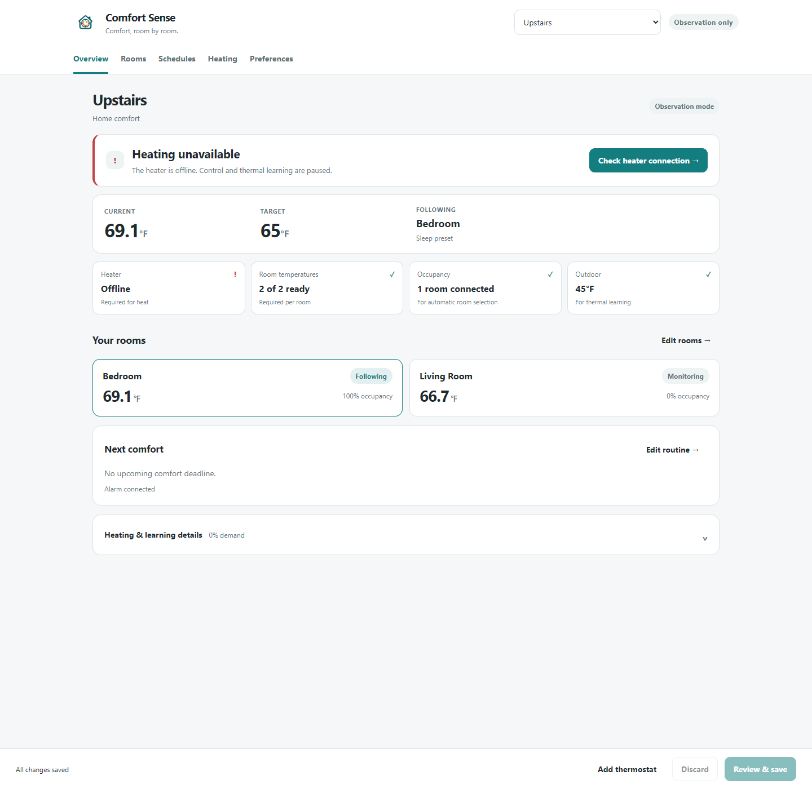

# Comfort Sense console

Open **Comfort Sense** in the Home Assistant sidebar. It is included in the
integration; no separate card, frontend download, YAML or external account is
needed. The console is available to administrators and follows HA's light/dark
theme and temperature units. The existing Configure flow and entity controls
remain available.

## Start with Overview

The first panel explains the current operating state and offers the next useful
action when something needs attention. The compact temperature strip shows the
current reading, effective target and selected room, grouped rooms or Average.
The target includes any active preset or comfort deadline.

Four connection tiles separate required heating inputs from optional occupancy
and outdoor inputs. Select a tile to open its setup page. Room cards show
temperature, occupancy history, active membership and learning status. Detailed
control diagnostics stay collapsed until needed. **Open thermostat controls**
opens the normal HA climate dialog.

Heat demand is the requested percentage of a heating cycle, not proof of burner
activity. Heater feedback, Shadow mode and the current control reason are shown
separately. Observation-only mode never sends heater commands.

## Rooms

Add a room, name it, and select its original temperature sensors. Search by
friendly name or entity ID; each result includes its current state and unit.
Only appropriate sensor types appear. Multiple sensors in one room are averaged.
Comfort Sense's own calculated temperature entities cannot be selected as inputs.

Occupancy sensors are optional. Rooms without them can still contribute to
Average. Required temperature inputs and optional occupancy inputs show live
connection status. Expand **Room behavior**, below the room cards, to change
reaction time or grouping tolerance. Medium uses 30 minutes of occupancy history.
The shared room protection buffer is under **Heating → Protection & cycling**.

Automatic tuning is the default. Expand **Room tuning** and choose Manual only
when needed; gain fields appear conditionally. Removing a room also removes its
schedule bindings and clears its Sleep-room selection. Review the draft before
saving.

## Schedules

Start with **Your routine** for the next comfort deadline and connected sources.
Expand **Edit morning alarms**, select each phone's next-alarm timestamp sensor, and choose
the target, room source and accepted wake-up window. Associate a person with a
phone to skip it while that person is away. The clock-app allow list is still a
setting of the phone's HA Companion app. Alarm readings display readable dates
and times in HA's configured time zone.

Weekly times remain in native **Schedule helpers**. Create/edit their weekly
blocks in HA's Helpers screen, then select the helper and target in the console.
The connection controls whether to warm up before the block starts. Additional
block-data units and overlap priority are under each schedule's expandable
settings. Existing migrated weekly data remains intact until a helper replaces it.

The **External preset schedules** section lists enabled external Scheduler
schedules that target this climate entity. It does not modify or import those
schedules. A warning identifies days shared by multiple schedules. Boost still uses the thermostat's configured duration, independently
of the length of an external Scheduler block.

## Heating and Preferences

Heating puts the required relay connection first, with optional outdoor and home
presence inputs below it. Expand **Protection & cycling** for minimum on/off
times, cycle length, the shared room buffer and absolute cutoff. Timing inputs
use minutes; the closed section summarizes the current values. Review a change out of Shadow mode carefully: it requires
acknowledging that other controllers of that relay have been stopped and the
relay must be available. Changing the relay or Shadow mode starts the thermostat
Off; use the normal thermostat controls to select Heat afterward.

Preferences starts with four temperature preset tiles. Boost duration and Sleep
room are under **Preset behavior**. **PID tuning & learning** and **Advanced sensor
& warm-up settings** stay collapsed by default. Average retains its own PID controller.
The default Sleep-room choice uses the thermostat's temperature source (Auto,
Average or the selected room). Select a specific Sleep room to pin it overnight.

[Mobile preset settings preview with example data](assets/console-preferences-mobile.png)

## Outdoor compensation and Ke

Comfort Sense uses a learned heat-loss feedforward term alongside PID. It does
not have Smart Thermostat's independent manual `ke` gain. The climate attributes
include `outdoor_temperature` (with its explicit Celsius unit) and
`outdoor_compensation`: status, actual applied feedforward duty, active status,
and the learned coefficient in heating-duty fraction per °C when available.

The coefficient comes from `loss_rate / heat_rate` in an accepted thermal model;
the model also includes a learned bias. Grouped-room compensation combines the
eligible member models. Without an accepted model, compensation stays at zero
and the status explains why. Manual PID mode does not apply learned feedforward.
Outdoor temperature still informs model-based warm-up forecasts when available.

The separate `target_origin` attribute identifies the preset, home-presence Away
override, or active schedule/alarm currently providing the target. It remains
visible even when a protection condition temporarily blocks heating.

## Save deliberately

Edits are drafts until **Review & save → Save changes**. Switching sections keeps
the draft. Changing thermostats asks before discarding unsaved edits. Discard
returns to the last loaded settings.

If settings change elsewhere while a draft is open, the backend refuses the stale
save. Reload the latest settings before editing again. Existing unavailable
entities may be retained so a temporary hardware outage does not prevent unrelated
edits. New selections must match the expected entity type.

Saving may reload this thermostat and enforce a fresh minimum off time. Existing
room IDs, entity preferences and compatible learned models remain intact. Other
integrations, external schedules and hardware are not changed by opening the page.
